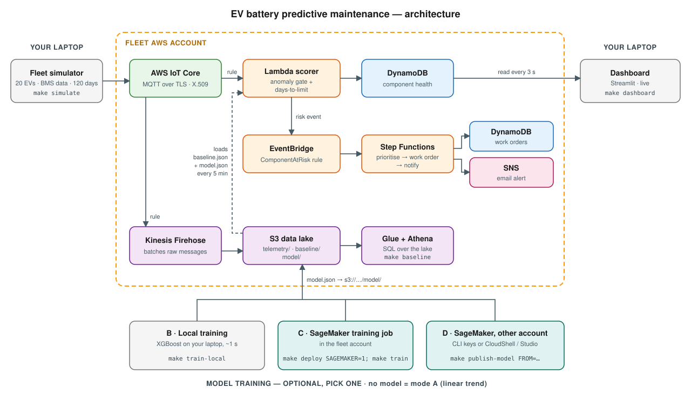

# EV predictive maintenance — beyond the battery (AWS PoC)

Predicts failures in the **motor bearing, coolant pump, inverter cooling, brake pads and tyres** of a connected EV fleet
and opens a service work order **weeks before** the vehicle's own fault code (DTC) would fire.

No hardware: a Python simulator stands in for 20 vehicles and plays 120 days of fleet life in about 2 minutes.
Everything else is real AWS, deployed with Terraform and sized for short-lived cloud sandboxes.

## Choose a mode

The fleet stack is the same in every mode. The only difference is where the days-to-limit estimate comes from.

| Mode | Commands | Days-to-limit from | Needs |
|---|---|---|---|
| **A. No ML** | `make deploy` | linear trend | one account |
| **B. ML, no SageMaker** | `make deploy` → `make train-local` | XGBoost trained on your laptop (~1 s) | one account |
| **C. ML with SageMaker** | `make deploy SAGEMAKER=1` → `make train` | XGBoost trained by a SageMaker job in the **same account** | one account that allows SageMaker |
| **D. Separate ML account** | `make deploy` → `make train-remote` or `make bundle` | XGBoost trained by SageMaker in **another account** | two accounts (e.g. A Cloud Guru + KodeKloud) |

All ML modes train the same model on the same data with the same code (`ml/sm_code/xgb_train.py`) and publish it to
`s3://<lake>/model/`. The Lambda runs it in plain Python: no endpoint to pay for, and no cross-account access in mode D.
Switch between modes at any time: `make unpublish-model` returns to A, and the next train or publish switches again.
The dashboard banner always shows which mode is active.

| Account | Profile | Runs |
|---|---|---|
| **Fleet** (e.g. A Cloud Guru sandbox) | `default` | IoT Core, Lambda scorer, DynamoDB, EventBridge, Step Functions, SNS, Firehose/S3/Glue/Athena; SageMaker training too in mode C |
| **ML**, mode D only (e.g. KodeKloud) | `kodekloud`, or console only | SageMaker training job |

## Architecture



1. **Ingest:** the simulator publishes one message per vehicle per simulated day to **IoT Core** over MQTT/TLS.
   A topic rule sends each message to the **Lambda scorer** and to **Firehose**.
2. **Score:** the Lambda updates each part's 30-day history and status in **DynamoDB**, which the dashboard reads.
3. **Act:** when a part gets worse (HEALTHY → AT_RISK → CRITICAL), the Lambda sends an **EventBridge** event.
   **Step Functions** then sets the priority, writes a work order to DynamoDB and emails an alert through **SNS**.
4. **Data lake:** Firehose lands raw telemetry in **S3**, queryable with **Glue + Athena**.
   `make baseline` learns the healthy-fleet baseline from it.
5. **Model (optional):** modes B, C and D each publish `model.json` to the lake. The Lambda reloads the baseline and
   the model every 5 minutes, and falls back to the linear trend when no model is published.

## How the scoring works

For each component, the Lambda keeps a 30-day window of one health indicator per vehicle.

| Component | Indicator | Limit |
|---|---|---|
| Motor bearing | vibration RMS (g) | 1.2 g |
| Coolant pump | coolant flow (L/min) | 6 L/min |
| Inverter cooling | inverter temp − coolant temp (°C) | 35 °C |
| Brake pads | thinnest pad (mm) | 3 mm |
| Tyres | lowest pressure (psi) | 30 psi |

1. **Anomaly gate — is this part degrading?** A z-score against the healthy-fleet baseline.
   z ≥ 4 → AT_RISK on its own. Below z = 2, no days-to-limit estimate is trusted, from either the model or the trend.
   This keeps healthy vehicles quiet. Brake pads wear by design, so they skip the gate.
2. **Days to limit — how soon?**
   - **SageMaker model** (when published): XGBoost regression trained on run-to-failure history.
     It uses 12 features (`lambda/scorer/health.py: features()`): margin to limit, 15-day and 5-day slope,
     acceleration, noise, z-score, linear-trend estimate and component type.
     It learns things a straight line can't, such as the accelerating wear of a failing bearing.
   - **Linear trend** (fallback): least squares over the last 15 days, extrapolated to the limit.
   - ≤ 45 days → AT_RISK, ≤ 14 days or past the limit → CRITICAL.
3. One work order per escalation (HEALTHY → AT_RISK → CRITICAL), not one per message.

### Training data and labels
The simulator produces fleet history for 500 vehicles with randomised faults (type, onset day, 0.5–2× severity),
about 30% of them healthy, each run for 300 days. Each (vehicle, component, day) window is labelled with
**the days until that part actually crossed its limit**, capped at 120.
Train (400 vehicles) and validation (100 vehicles) are different fleets.
In a real OEM these labels come from repair and warranty records joined to telemetry. That join is the real project.

### Model vs. trend (`make evaluate`, offline)

| Demo fleet fault | Trend warns | Model warns | Limit reached |
|---|---|---|---|
| EV-015 aggressive braking | day 18 | **day 12** | day 44 |
| EV-007 coolant pump | day 40 | **day 29** | day 89 |
| EV-011 slow tyre leak | day 40 | **day 34** | day 68 |
| EV-003 motor bearing | day 44 | day 44 | day 90 |

Across 20 different simulated fleets (320 healthy vehicles, 80 faults): the model gives **~44 days** average warning
vs ~41 for the trend, misses nothing, and raises **1 false alarm** vs 0. Validation MAE is ~13 days overall and ~15 days
for parts failing within 60 days. It's an honest trade-off to present: earlier warnings, slightly more noise.

## Run it

### 0. Local setup (once)
Needs `make`, Python 3.10+, Terraform ≥ 1.5, the AWS CLI and, on macOS, `brew install libomp` (for local xgboost).

**Installing `make`.** Check with `make --version`; any GNU Make 3.81 or newer works.

| OS | Install |
|----|---------|
| macOS | `xcode-select --install` (Command Line Tools; includes `make` and `git`). Or `brew install make`, which installs it as `gmake`. |
| Ubuntu / Debian / WSL | `sudo apt-get update && sudo apt-get install -y make` (or `build-essential`) |
| Amazon Linux / RHEL / Fedora | `sudo dnf install -y make` (`yum` on older versions) |
| Windows | Use **WSL** (`wsl --install`, then the Ubuntu row above). The Makefile uses bash and `.venv/bin/`, so native Windows `make` (Chocolatey / winget) won't run it. |

No `make`? Each target is a short shell command. `make help` lists them, and you can run the commands from the
`Makefile` directly.

```bash
cd ~/Downloads/ev-demo
make venv
make test          # offline tests, including the SageMaker entry point
make evaluate      # optional: local model vs trend comparison (~30 s)
```

### 1. Point the CLI at the fleet sandbox
```bash
aws configure                       # A Cloud Guru keys into the default profile, region us-east-1
aws sts get-caller-identity          # should show cloud_user
```
Keys in a named profile instead? Pass `FLEET_PROFILE=<name>` to any `make` command.
The ML account needs **no CLI keys**: training runs inside its console (step 3).

### 2. Deploy the fleet stack (~2–3 min)
```bash
make deploy                       # modes A, B, D
make deploy SAGEMAKER=1           # mode C: also creates a SageMaker execution role
# add EMAIL=you@example.com for SNS alerts (confirm the subscription email first)
```
`SAGEMAKER=1` can be added to an existing deployment at any time; it only adds one IAM role.

### 3. Pick how days-to-limit is estimated

**Mode A: no ML.** Nothing to do; the scorer uses the linear trend.

**Mode B: ML without SageMaker (~1 s):**
```bash
make train-local                  # trains XGBoost on this machine and publishes it
```

**Mode C: ML with SageMaker, same account (~5–8 min, mostly instance start-up):**
```bash
make train                        # options: make train ARGS="--instance-type ml.m5.xlarge"
```
This runs a SageMaker training job with the role Terraform created. Data, code and artifacts go to
`s3://<lake>/sagemaker/`, and the model is published to `s3://<lake>/model/` automatically. Watch the job, its logs and
the `validation:mae` metric in the SageMaker console.

**Mode D: separate ML account.** With CLI keys for it: `aws configure --profile kodekloud`, then
`make train-remote && make publish-model`. With **console access only** (KodeKloud), follow these steps:

1. On your laptop: `make bundle` → `dist/ev-pdm-sagemaker.zip` (7 files, ~30 KB).
2. Log in to the KodeKloud AWS console, switch the region to **us-east-1**, and open **CloudShell**
   (terminal icon in the top bar). If CloudShell is blocked, use a terminal in **SageMaker Studio**
   (JupyterLab → File → New → Terminal) instead.
3. **Actions → Upload file** → choose `ev-pdm-sagemaker.zip`. In Studio, drag it into the file browser.
4. Run:
   ```bash
   mkdir -p ev-pdm && cd ev-pdm && unzip -o ~/ev-pdm-sagemaker.zip
   python3 -c "import boto3" 2>/dev/null || pip3 install --user boto3
   python3 ml/train_sagemaker.py
   ```
5. When it prints `saved …/ml/.model/ev-pdm-model.json`, download that file. In CloudShell: **Actions → Download file**,
   path `ev-pdm/ml/.model/ev-pdm-model.json`. In Studio: right-click → Download.
6. On your laptop:
   ```bash
   make publish-model FROM=~/Downloads/ev-pdm-model.json
   ```

The script needs only Python 3.9+ and boto3. It creates `sagemaker-ev-pdm-<account>-<region>` for data and artifacts;
the `sagemaker-` prefix is what AWS's managed SageMaker policies allow. For the execution role it tries, in order:
its own `ev-pdm-sagemaker-exec` (if you may create roles), any existing role SageMaker can assume, then the role
you're running as (Studio). To choose one yourself: `python3 ml/train_sagemaker.py --role-arn arn:aws:iam::…`.
Other options: `--instance-type ml.m5.xlarge`, `--region us-west-2`.

Compare modes live: `make reset && make simulate` once per mode, and watch the banner and the *model* / *trend* columns.

### 4. Demo
```bash
make dashboard                    # terminal 1 → http://localhost:8501
make simulate                     # terminal 2 → 120 simulated days, 1 s per day
```
The dashboard banner shows whether days-to-limit comes from the SageMaker model or the linear trend.
- Replay: `make reset`, then `make simulate`.
- Switch modes: `make unpublish-model` (A), `make train-local` (B), `make train` (C) or `make publish-model` (D), then replay. Allow 5 minutes after each switch.
- Slower for live narration: `make simulate ARGS="--tick 2"`.
- Optional: `make baseline` (after ~1 min of simulation) learns the fleet baseline from the data lake with Athena.

### 5. Tear down
```bash
make destroy                      # fleet account; the ML sandbox is wiped when it expires
```

## Demo script (~12 min)

1. **Two accounts** (30 s): "Fleet operations here; ML training there. The model is a versioned artifact, so the teams and accounts stay separate."
2. **SageMaker console, ML account**: open the training job. Show the hyperparameters, the instance, the `validation:mae` metric, and the model artifact in S3.
3. **Dashboard, day 0–10.** The green banner names the training job. "20 vehicles over MQTT into IoT Core, scored as each message arrives."
4. **Day ~12: EV-015 brake pads turn amber.** "Pads are still over 5 mm, so no DTC. The model says this driver hits the limit in about 39 days." Show the work order and the SNS email.
5. **Day ~29: EV-007 coolant pump.** Open its trend chart. "The model flags it 11 days before a straight-line trend would, and about 60 days before the vehicle's own coolant DTC." The *model* and *trend* columns show both estimates side by side.
6. **Step Functions console**: Prioritise → CreateWorkOrder → Notify.
7. **Athena**: the raw data in the lake, which is what the next model gets retrained on.
8. **Simulator terminal**: the DTCs finally fire on days 44, 68, 89 and 90.

### Athena queries
```sql
-- fleet coolant-flow trend
SELECT sim_day, vehicle_id, cooling.pump_flow_lpm
FROM telemetry WHERE vehicle_id IN ('EV-007', 'EV-001') ORDER BY sim_day;

-- when did each DTC first appear?
SELECT vehicle_id, d AS dtc, min(sim_day) AS first_day
FROM telemetry CROSS JOIN UNNEST(dtc) AS t(d) GROUP BY 1, 2 ORDER BY 3;
```

## Troubleshooting

- **Region:** both default to `us-east-1`. Fleet: `terraform -chdir=infra apply -var region=us-west-2`. ML (mode D): `make train-remote SM_REGION=us-west-2`; mode C follows the fleet region.
- **Fleet sandbox blocks Firehose or Glue/Athena:** `terraform -chdir=infra apply -var enable_data_lake=false`. Scoring, work orders and the dashboard still work.
- **`make train` / `train-remote` fails on the instance type:** sandboxes often allow only certain sizes. Try `ARGS="--instance-type ml.m4.xlarge"` or `ml.c5.xlarge`.
- **No role found:** in the IAM console, find a role whose trusted entity is SageMaker and pass `--role-arn`.
- **The banner still says "linear trend" after publishing:** the Lambda reloads the model every 5 minutes.
- **Nothing on the dashboard:** check the Lambda logs:
  `aws logs tail /aws/lambda/$(python3 -c "import json;print(json.load(open('config.json'))['scorer_function']['value'])") --follow`
- **Simulator can't connect:** a new fleet sandbox needs a fresh `make deploy`, because the cert and `config.json` belong to that deployment.
- **Cost:** one ml.m5.large training job (a few minutes), plus serverless / pay-per-request for everything else.

## What's simulated vs. production

| PoC | Production path |
|---|---|
| Python simulator, one cert for the whole fleet | One identity per vehicle via the TCU; fleet provisioning; edge signal collection |
| One summarised message per vehicle per simulated day | Higher-rate signals aggregated at the edge or in a stream processor (Kinesis / Managed Flink) |
| Labels from simulated run-to-failure history | Labels from repair, warranty and parts-replacement records joined to telemetry |
| Model copied between accounts from a laptop | SageMaker Model Registry + pipeline, cross-account deployment, scheduled retraining from the lake |
| Model runs inside the Lambda | Same for small tree models; a SageMaker endpoint for larger models or for retraining without redeploying |
| Work order in DynamoDB + SNS email | Dealer management / booking system integration, Amazon Connect outreach |
| Local Streamlit dashboard | QuickSight or an internal web app |
